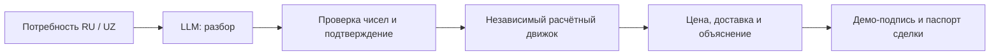
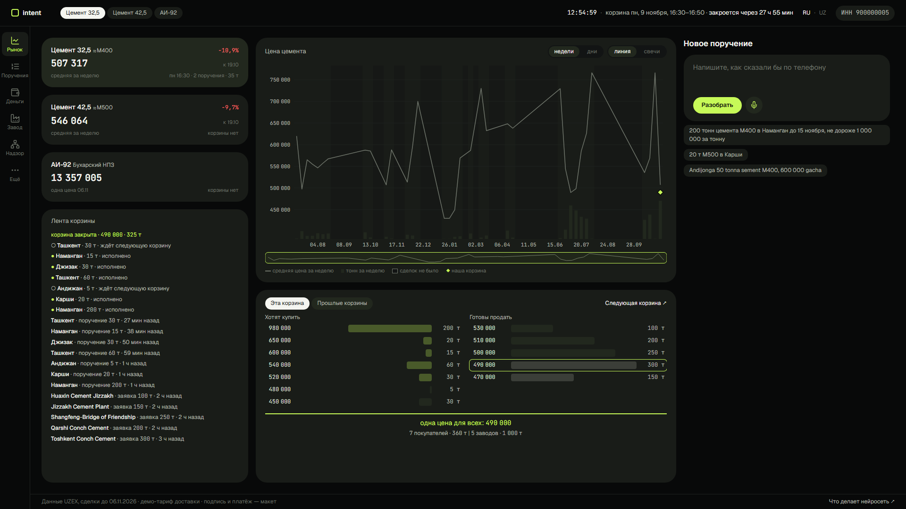

<p align="center"></p>

# Intent — «Биржа намерений»

**Биржевой MVP с голосовым и текстовым вводом поручений на русском и узбекском.** Прототип для финала UZEX «The Exchange of 2035», ноябрь 2026.

Покупатель описывает потребность обычными словами, проверяет извлечённые параметры и подтверждает поручение. Программа рассчитывает цену и показывает, откуда взялись числа.

## Что делает MVP

- Извлекает параметры из голоса и текста, уточняет недостающее и требует подтверждения чисел.
- Рассчитывает единую цену, доставку и объединение небольших заказов.
- Показывает сбор, задаток, объяснение цены и паспорт сделки.
- Демонстрирует путь от поручения до корзины торгов, демо-подписи и демо-эскроу.
- Содержит интерфейсы покупателя, завода и наблюдения за рынком.



## Исследование и вклад

Материалы UZEX собирались из открытых источников, форумов и Telegram-каналов с помощью ChatGPT, Gemini, Perplexity и Claude Code. Они использовались для поиска идей и подготовки контекста AI-прототипирования. Реализация MVP — командная работа; личный вклад владельца портфолио — исследование, сбор и структурирование материалов.

Из исследования в прототип перешли два решения: уточнение единиц, валюты и условий поставки перед сравнением предложений; отдельное отображение сбора, задатка и доставки.

## Стек и структура

| Часть | Технологии / папка |
|---|---|
| API и расчёты | Python, FastAPI, Pydantic, DuckDB, pandas, NetworkX — `backend/` |
| Интерфейс | React, TypeScript, Vite, Tailwind CSS — `frontend/` |
| Проверки | pytest, Hypothesis, Vitest |
| Питч и сценарий | `pitch/`, `docs/DEMO_SCRIPT.md` |
| Данные | `data/demo/` — демонстрационные; `data/raw/` — сохранённые рыночные выборки |

## Локальный запуск

Нужны Python 3.12 и Node.js 24+. Секреты необязательны для офлайн-демо.

```sh
python3.12 -m venv .venv
.venv/bin/pip install --require-hashes -r backend/requirements.lock
cp .env.example .env
.venv/bin/python scripts/build_db.py
# В первом терминале из backend/:
../.venv/bin/python -m uvicorn app.main:app --host 127.0.0.1 --port 8000
# Во втором терминале из frontend/:
npm ci
npm run dev
```

Для воспроизводимого сценария задайте в `.env` `DEMO_OFFLINE=1`. Параметры модели и доступа перечислены в `.env.example`. Голосовые облачные провайдеры требуют собственных ключей; их не передают в клиентский код.

## Проверки

```sh
# из backend/, с активированной средой
python -m pytest -q
# из frontend/
npm test
npm run build
npm audit
```



## Ограничения и безопасность

Подпись, платёж, реестры и эскроу **демонстрационные**. Прототип не предназначен для настоящих денег или юридически значимых торгов. LLM не определяет цену: числа считает отдельный движок. Демо-книга хранится в памяти.

Локальный режим не следует открывать в интернет. Для отдельного размещения включают `ENV=prod`, задают уникальные `ADMIN_TOKEN` и `AUTH_SECRET`, коды доступа и точный `CORS_ORIGINS`; публикуют через HTTPS-прокси. Конфигурации реального сервера и выданные коды в репозиторий не включены.

См. [проверку безопасности](docs/SECURITY_REVIEW.md) и [модель доступа](docs/ACCESS.md).
